<p align="center">
  
</p>

<p align="center">
  <a href="https://github.com/jeiel85/homebase/actions"></a>
  <a href="https://github.com/jeiel85/homebase/blob/main/LICENSE"></a>
  <a href="https://dotnet.microsoft.com/"></a>
  <a href="https://github.com/jeiel85/homebase/issues"></a>
</p>

<p align="center">
  <b>Homebase</b> &mdash; 개인 Windows PC 상태, 부팅, 장애, 알림을 Telegram으로 확인하고 알림받는 개인용 모니터링 봇입니다.<br>
  인터넷에 포트를 열지 않습니다. Telegram은 outbound HTTPS, 휴대폰 앱은 같은 LAN(TLS)·Tailscale 망·Cloudflare Tunnel(outbound) 중 되는 경로로 연결합니다.
</p>

<p align="center">
  <a href="#-기능">기능</a> •
  <a href="#-시작하기">시작하기</a> •
  <a href="#-명령어">명령어</a> •
  <a href="#-아키텍처">아키텍처</a> •
  <a href="#-기술-스택">기술 스택</a> •
  <a href="#-프로젝트-구조">프로젝트 구조</a>
</p>

---

## ✨ 기능

| | 기능 | 설명 |
|---|---|---|
| 🖥️ | **시스템 상태** | CPU, RAM, 디스크, 네트워크, 가동 시간을 Telegram으로 확인 |
| 🚀 | **부팅 알림** | PC가 부팅되면 Telegram으로 즉시 알림 |
| 👁️ | **프로세스/서비스 감시** | Ollama, PostgreSQL, 개발 서버 등의 상태 모니터링 |
| 📋 | **이벤트 로그 감시** | Windows 오류/심각 이벤트를 Telegram으로 전달 |
| 🔔 | **토스트 알림 전달** | Windows 알림을 프라이버시 필터링·앱별 묶음과 함께 휴대폰 앱으로 암호화 전달(기본 켜짐) |
| 📲 | **앱 푸시 알림** | 경보·부팅·Windows 알림을 Homebase 앱으로 UnifiedPush 종단 암호화(RFC 8291) 전송, 실패 시에만 Telegram |
| 🔒 | **프라이버시 우선** | 비밀번호, OTP, 토큰 마스킹; 민감 앱 차단 |
| 🔇 | **조용한 시간** | `/mute 1h`로 일시적으로 알림 음소거 |
| 📊 | **SQLite 로깅** | 명령 및 알림 이력 영구 저장 |
| 📱 | **휴대폰 실시간 모니터링** | 여러 PC를 QR로 등록하고, 열린 창·창별 CPU/RAM/I/O/네트워크·Claude Code 세션을 실시간으로 확인 (Android, 아래 참고) |

## 🚀 시작하기

### 사전 요구사항

- Windows 10/11 (버전 1809 이상)
- Telegram 계정 + [BotFather](https://t.me/BotFather) 봇 토큰
- 설치 파일에 .NET 런타임이 포함되어 있어 **별도 런타임 설치는 필요 없습니다**

### 설치 — 어느 파일을 받나요?

[**최신 릴리스**](https://github.com/jeiel85/homebase/releases/latest)에서 상황에 맞는 파일 하나만 받으세요.

| 파일 | 이럴 때 받으세요 |
|---|---|
| **`Homebase-Setup.exe`** | ⭐ **대부분 이것 하나면 됩니다.** 더블클릭하면 마법사가 토큰·chat ID를 묻고 설치를 끝냅니다 |
| `Homebase-Setup.zip` | 마법사 없이 수동 설치. 압축을 풀고 **관리자** PowerShell에서 `.\setup.ps1` 실행 |
| `bootstrap.ps1` | 명령 한 줄 설치 (아래 방법 B) |

**방법 A — 설치 마법사 (권장)**

1. `Homebase-Setup.exe`를 받아 더블클릭
2. **Windows SmartScreen** 경고("Windows의 PC 보호")가 뜨면 → **추가 정보** → **실행**을 누르세요. 서명되지 않은 개인용 앱이라 표시되는 정상 경고입니다
3. 마법사가 물어보는 Telegram 봇 토큰과 chat ID 입력
4. 설치가 끝나면 Telegram에서 봇에게 `/ping` 전송

**방법 B — 한 줄 설치**

**관리자 권한** PowerShell에서:

```powershell
irm https://github.com/jeiel85/homebase/releases/latest/download/bootstrap.ps1 | iex
```

> **chat ID를 모르나요?** 봇에게 아무 메시지나 보낸 뒤 `https://api.telegram.org/bot<봇토큰>/getUpdates`를 열어 `chat.id` 값을 확인하세요.

### 직접 빌드

[.NET 9 SDK](https://dotnet.microsoft.com/download/dotnet/9.0)가 필요합니다.

```powershell
dotnet build LocalOpsBot.sln
```

## 🤖 명령어

| 명령어 | 설명 |
|---|---|
| `/ping` | 봇 상태 확인 |
| `/help` | 사용 가능한 명령어 표시 |
| `/status` | 전체 PC 상태 (CPU, RAM, 디스크, 네트워크) |
| `/uptime` | 시스템 가동 시간 |
| `/disk` | 드라이브별 디스크 사용량 |
| `/process` | 감시 중인 프로세스 상태 |
| `/services` | Windows 서비스 상태 |
| `/events` | 최근 Windows 이벤트 로그 |
| `/alerts` | 최근 알림 이력 |
| `/mute 1h` | 일정 시간 동안 알림 음소거 |
| `/unmute` | 알림 다시 활성화 |
| `/diagnostics` | 에이전트 자체 진단 |

## 📱 휴대폰 앱 (Homebase Mobile)

PC에서 에이전트로 돌리는 작업을 휴대폰에서 실시간으로 지켜봅니다. 집·회사·노트북 PC를 여러 대 등록하고 목록에서 골라 들어가면
그 PC의 **열린 창 목록**(Chrome은 창마다 활성 탭 제목), **창(프로세스)별 CPU·RAM·I/O·네트워크**, **최근 활동한 Claude Code 세션 제목**이 1초마다 갱신됩니다.

- **연결 (Tailscale은 선택)**: QR 한 장에 PC로 가는 경로가 모두 들어 있고, 앱이 휴대폰의 현재 네트워크를 보고 알아서 고릅니다.
  1. **같은 Wi-Fi·유선(LAN)**: 가장 빠릅니다. PC의 사설 주소로 TLS 연결하며, 앱은 QR에 담긴 PC 인증서 지문만 신뢰합니다.
     Windows가 그 네트워크를 **개인(Private)** 으로 분류해야 열립니다(공용이면 Connect Phone… 창이 알려 줍니다).
  2. **[Tailscale](https://tailscale.com/)**: PC와 휴대폰이 같은 tailnet에 있으면 어디서든 직접 연결합니다.
  3. **Cloudflare Tunnel**: Tailscale 없이 밖에서 볼 때 씁니다. PC가 Cloudflare로 outbound 연결만 하므로 공유기 포트를 열지 않습니다.
     토큰을 넣지 않으면 계정 없는 Quick Tunnel(임시 주소, PC 재시작마다 바뀜 — 앱이 LAN/Tailscale로 한 번 붙으면 새 주소를 자동으로 배움)을,
     Cloudflare 대시보드에서 만든 터널의 토큰과 공개 호스트명을 넣으면 고정 주소를 씁니다. `cloudflared`가 필요하며 창에서 바로 설치할 수 있습니다.
  어느 경로든 인증은 같은 페어링 토큰(Bearer)이고, 앱 상세 화면 위쪽에 지금 붙은 경로(LAN/Tailscale/Cloudflare)가 표시됩니다.
- **가벼움**: 휴대폰이 상세 화면을 보고 있을 때만 수집합니다. 보지 않을 때 추가 부하는 사실상 0입니다.
- **설치**: [최신 릴리스](https://github.com/jeiel85/homebase/releases/latest)의 `Homebase-Mobile.apk`를 휴대폰에서 받아 설치합니다. 이후 업데이트는 앱이 하루 한 번 확인해 알려 줍니다.
- **연결하기**: PC 트레이 아이콘 우클릭 → **휴대폰 연결…**(영어 Windows: Connect phone…) → 쓸 경로를 고르고(기본: 전부) ENABLE과 관리자 승인 → 표시된 QR을 앱의 **PC 추가**로 스캔합니다.
  앱이 아직 없다면 휴대폰 **기본 카메라**로 QR을 찍으세요. 설치 안내 페이지가 열리고, 설치 후 그 페이지의 **앱에서 열기**로 바로 연결이 이어집니다.
  창의 CONNECTION PATHS에서 경로별 상태를 보고, 빠진 구성 요소(Tailscale·cloudflared)는 INSTALL(winget)로 설치합니다.
  QR은 5분 동안 한 번만 쓸 수 있고, 같은 창에서 연결된 휴대폰을 해제할 수 있습니다.
- **푸시 알림 (UnifiedPush)**: PC 경보(프로세스·서비스·HTTP·포트 다운, 이벤트 로그, AI 조언), 부팅 알림, Windows 알림이 앱 알림으로 옵니다.
  휴대폰에 UnifiedPush 배포자 앱 하나가 필요합니다. [ntfy](https://ntfy.sh/)(무료, 계정 없음)를 Play 스토어나 F-Droid에서 설치하면
  Homebase 앱이 처음 PC를 연결할 때 알아서 켭니다(앱 목록 아래 **푸시 알림** 스위치). 내용은 PC에서 휴대폰 키로 암호화(RFC 8291)되어
  ntfy 서버는 암호문만 봅니다. 알림 채널이 PC·앱별로 나뉘므로 Android 알림 설정에서 원하는 것만 끌 수 있습니다.
  - 전환 기간에는 Telegram이 대체 채널입니다. 푸시를 등록한 휴대폰이 없거나 전송이 실패한 경보만 Telegram으로 갑니다.
    **Windows 알림은 Telegram으로 보내지 않습니다**(평문 클라우드). 예전처럼 받으려면 `notificationForwarding.telegramFallback: true`.
  - Windows 알림 포워딩은 이제 기본 켜짐이며 1Password·Bitwarden·Authy 등은 항상 차단, 6자리 코드·비밀번호·토큰은 마스킹합니다.
    같은 앱의 알림은 `bundleSeconds`(기본 60초) 동안 한 건으로 묶고, 하루 `maxPushesPerDay`(기본 150건)를 넘으면 버립니다.
    ntfy.sh 익명 한도가 휴대폰(구독자) IP당 하루 250건이고 모든 PC가 이를 나눠 쓰기 때문입니다(2026-11-13 확인). PC가 여러 대면 이 값을 줄이세요. 설정 파일에 `"enabled": false`가 이미 적혀 있으면 그대로 꺼져 있습니다.
- 프로세스별 네트워크는 Agent가 관리자 권한(서비스)으로 돌 때만 집계되고, Claude 세션은 제목·폴더·시간만 읽습니다(대화 내용은 읽지 않음).
  설정의 `mobile.claudeSessions: false`로 끌 수 있습니다. 프로토콜은 [`docs/MOBILE_PROTOCOL.md`](docs/MOBILE_PROTOCOL.md)를 참고하세요.

## 🌡️ 온도 모니터링

`/status`와 조언(`/advise`)에 CPU·보드 온도가 함께 표시됩니다. 센서 백엔드는 두 가지입니다.

- **기본값 — WMI/ACPI 센서:** 커널 드라이버를 로드하지 않아 백신에 탐지되지 않습니다. 다만 메인보드 ACPI 존 온도만 제공하며, **많은 데스크톱은 이 값을 노출하지 않아** 온도가 표시되지 않을 수 있습니다.
- **정밀 센서(opt-in) — LibreHardwareMonitor:** CPU 코어별·GPU·보드 온도까지 읽지만, 이를 위해 **WinRing0 커널 드라이버**를 로드합니다. Windows Defender는 이 드라이버를 취약 드라이버(`VulnerableDriver:WinNT/Winring0`)로 분류합니다.

정밀 센서를 켜려면 **관리자 PowerShell**에서:

```powershell
& "C:\Program Files\Homebase\enable-temperature.ps1"
```

이 스크립트는 설정을 `LibreHardware`로 바꾸고, 드라이버에 대한 **Defender 예외를 자동 등록**한 뒤 서비스를 재시작합니다. 되돌리려면 `-Disable`을 붙여 실행하세요.

> **보안 주의:** Defender 예외는 백신 *탐지*만 숨깁니다. 이 PC가 취약 드라이버 차단목록(메모리 무결성/HVCI/Smart App Control — 최신 Windows 11에서 기본 켜짐)을 적용 중이면, 예외와 무관하게 드라이버 로드가 커널 수준에서 차단되어 온도가 여전히 비어 있을 수 있습니다. 그 경우 기본 WMI 센서를 유지하세요.

## 🏗️ 아키텍처

```
┌─────────────────────────────────────────────┐
│ Telegram 모바일/데스크톱                     │
└───────────────────┬─────────────────────────┘
                    │
                    ▼
┌─────────────────────────────────────────────┐
│ Telegram Bot API (outbound HTTPS, polling)   │
└───────────────────┬─────────────────────────┘
                    │
                    ▼
┌─────────────────────────────────────────────┐
│ 로컬 Windows PC                              │
│                                               │
│  ┌─────────────────────────────────────────┐ │
│  │ LocalOpsBot.Agent (Windows 서비스)       │ │
│  │ • 부팅 알림                             │ │
│  │ • 상태 수집기                           │ │
│  │ • 이벤트 로그 감시                      │ │
│  │ • 프로세스/서비스 감시                  │ │
│  │ • Telegram 폴링                         │ │
│  └───────────────────┬─────────────────────┘ │
│                      │ Named Pipe IPC        │
│  ┌───────────────────▼─────────────────────┐ │
│  │ LocalOpsBot.Tray (사용자 세션 앱)        │ │
│  │ • 토스트 알림 리스너                    │ │
│  │ • 알림 필터/마스킹                      │ │
│  │ • 로컬 설정 UI                          │ │
│  └─────────────────────────────────────────┘ │
│                                               │
│  ┌─────────────────────────────────────────┐ │
│  │ LocalOpsBot.Data (SQLite)               │ │
│  └─────────────────────────────────────────┘ │
└─────────────────────────────────────────────┘
```

## 🛠️ 기술 스택

<p>
  
  
  
  
  
  
  
</p>

| 구성요소 | 기술 |
|---|---|
| 런타임 | .NET 9 |
| 언어 | C# 12 |
| IPC | Named Pipes (length-prefixed JSON) |
| 데이터베이스 | SQLite via Microsoft.Data.Sqlite |
| UI (트레이) | WPF |
| 봇 프로토콜 | Telegram Bot API (long polling) |
| DI/호스팅 | Microsoft.Extensions.Hosting |
| 로깅 | Serilog |
| 테스팅 | xUnit |

## 📁 프로젝트 구조

```
LocalOpsBot/
├─ src/
│  ├─ LocalOpsBot.Core/           # 도메인 모델, 인터페이스
│  ├─ LocalOpsBot.Infrastructure/ # Telegram, Windows 수집기
│  ├─ LocalOpsBot.Data/           # SQLite 영속성
│  ├─ LocalOpsBot.Agent/          # Windows 서비스 진입점
│  └─ LocalOpsBot.Tray/           # WPF 트레이 앱
├─ mobile/                        # Android 앱 (Kotlin/Compose)
├─ tests/
│  └─ LocalOpsBot.Tests/          # 단위 및 통합 테스트
├─ installer/                     # PowerShell 스크립트
├─ config/                        # 설정 예시
├─ docs/                          # GitHub Pages 랜딩 페이지
└─ assets/                        # 이미지, 배너
```

## 📄 라이선스

MIT &mdash; 자세한 내용은 [LICENSE](LICENSE) 파일을 참고하세요.

---

<p align="center">
  <sub>.NET과 ❤️로 만들었습니다</sub>
</p>
